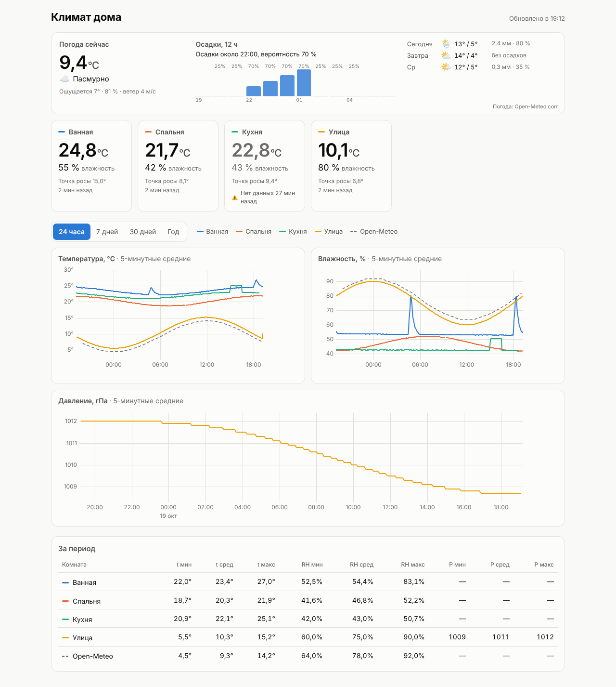
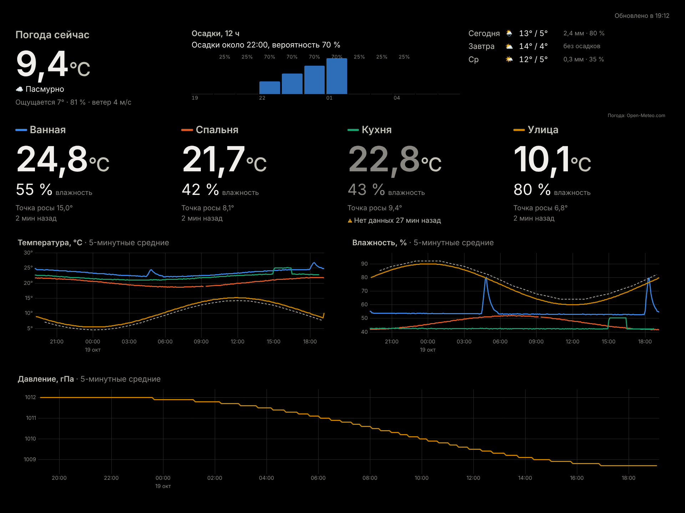

# temphum — климат дома и на улице: ESP32 + Cloudflare

Датчики температуры, влажности и давления → бесплатный Cloudflare → дашборд на iPhone, ноутбуке, умном зеркале и ТВ.
Дашборд также показывает погоду и прогноз осадков от Open-Meteo для координат дома.



```
ESP32 (1–3 датчика: дом / улица)  ──HTTPS POST /api/ingest (пачка замеров, токен на датчик)──►  Worker
                                                                                               │
                        D1 (SQLite): readings_raw ─cron─► readings_hourly ─► readings_daily    │
                                                                                               │
Дашборд (статика того же Worker) ◄── /api/devices, /api/series ───────────────────────────────┘
        └── погода и осадки: напрямую из браузера в api.open-meteo.com (без ключа)
```

| Папка | Что внутри |
|---|---|
| `worker/src/index.js` | API + cron-агрегация + чистка старых данных |
| `worker/migrations/` | схема базы D1 (миграции применяются по порядку) |
| `worker/public/` | дашборд: HTML/JS, графики uPlot, погода (`weather.js`), PWA для iPhone |
| `worker/scripts/add-device.mjs` | регистрация датчика и выпуск токена |
| `firmware/climate_node/` | прошивка ESP32 (Arduino IDE) |
| `docs/ARCHITECTURE.md` | архитектура и решения (в т.ч. почему ушли с MongoDB Atlas) |

## Возможности

- **До 3 датчиков на плате** (например, AM2301 в доме и AM2301 на улице). Каждый датчик — отдельная карточка и линия на графике.
- **Датчики:** AM2301/DHT21, DHT22, DHT11, BME280 (плюс атмосферное давление).
- **Два режима питания:**
  - от USB: замер раз в минуту;
  - **deep sleep** для батареи: плата просыпается, мерит и засыпает, Wi-Fi включается раз в N замеров, канал и точка доступа кэшируются для быстрого подключения.
- **Работа без связи:** замеры копятся на плате и досылаются, когда Wi-Fi вернётся.
- **Погода Open-Meteo:**
  - сейчас: температура, ощущается как, ветер;
  - осадки на 12 часов по часам;
  - прогноз на 3 дня;
  - линия «Open-Meteo» на графиках температуры и влажности, чтобы сравнить со своим уличным датчиком.
- **Агрегация в облаке:** почасовые и суточные min/среднее/max. Сырые данные удаляются через 30 дней, суточные хранятся всегда.
- **Режим зеркала/ТВ** (`?kiosk=1`): чёрный фон, крупные цифры, без кнопок.

## 1. Развернуть облако

Нужен бесплатный аккаунт Cloudflare и Node.js 20+.

```bash
cd worker
npm install
npx wrangler login
npx wrangler d1 create climate     # скопируйте database_id в wrangler.toml
```

В `worker/wrangler.toml`:
- `database_id` — из вывода предыдущей команды;
- `TZ` — часовой пояс (по нему считаются границы суток), например `"Europe/Kyiv"`;
- `SITE_LAT` / `SITE_LON` — координаты для погоды. Двух знаков после запятой достаточно (~1 км). Пустые — блока погоды не будет.

```bash
npm run db:migrate                 # создаёт / обновляет таблицы
npm run deploy                     # https://climate-monitor.<субдомен>.workers.dev
npx wrangler secret put READ_KEY   # ключ для просмотра дашборда (рекомендуется)
```

### Обновление уже развёрнутого воркера

Если облако развёрнуто по прошлой версии README (через `db:init`):

```bash
git pull                           # или распакуйте новую версию поверх
cd worker
npm install
npm run db:migrate                 # 0001 пропустит существующие таблицы, 0002 добавит давление и признак «улица»
npm run deploy
```

Свои `database_id`, `TZ` и координаты в `wrangler.toml` сохраните. Данные и токены датчиков остаются.

## 2. Зарегистрировать датчики

Каждый датчик — отдельное устройство со своим токеном, даже если они на одной плате.
Запускайте через `node` (в PowerShell `npm run … --` теряет аргументы):

```bash
node scripts/add-device.mjs home    "Дом"   1
node scripts/add-device.mjs outside "Улица" 2 --outdoor
```

- `--outdoor` — датчик на улице: у него не будет советов «Высокая влажность / Сухой воздух».
- Число — порядок карточек и цвет линии.

Сохраните оба `DEVICE_TOKEN`. Повторный запуск для того же id выпускает новый токен, старый перестаёт работать.

## 3. Прошить ESP32

1. Arduino IDE → Boards Manager → **esp32 by Espressif** → плата **ESP32 Dev Module**.
2. Library Manager → **Adafruit Unified Sensor** и библиотеки под ваши датчики:
   - **DHT sensor library** (Adafruit) — для AM2301/DHT;
   - **Adafruit BME280 Library** — для BME280.
3. `firmware/climate_node/config.example.h` → скопировать в `config.h` и заполнить:
   - Wi-Fi;
   - `SENSOR_COUNT`, для каждого датчика модель, GPIO и токен;
   - `POWER_MODE`.
4. Загрузить прошивку и открыть Serial Monitor на 115200:

```
[sensor 1] 23.4 C, 48.0 %  (buffered 1)
[sensor 2] 9.8 C, 81.0 %  (buffered 1)
[http 1] sent 1, buffered 0: {"ok":true,"accepted":1,...}
[http 2] sent 1, buffered 0: {"ok":true,"accepted":1,...}
```

### Подключение

**Два AM2301 на одной плате:**
- красные → 3V3;
- чёрные → GND;
- жёлтые → разные GPIO (например, 5 и 4);
- если чтение нестабильно — резистор 4,7–10 кОм между DATA и 3V3 у каждого датчика.

**Уличный датчик:**
- Ставить в тени и в защитном домике (радиационный экран, «будка Стивенсона»), иначе солнце завысит температуру на 5–10 °C.
- Кабель DHT/AM2301 до 10–20 м — нормально.
- BME280 (I2C) на длинном кабеле работает плохо (до ~1 м). Для улицы лучше AM2301/DHT22, а BME280 держать у платы.

**BME280:** SDA → GPIO 21, SCL → GPIO 22. Модули «BME/BMP280» часто оказываются BMP280 без влажности — прошивка об этом напишет.

### Батарея и deep sleep

```c
#define POWER_MODE         POWER_DEEP_SLEEP
#define READ_INTERVAL_S    300   // замер раз в 5 мин
#define SEND_EVERY_N_READS 6     // Wi-Fi раз в 30 мин
```

- **Отображение на дашборде:** данные приходят пачками раз в 30 минут. «Нет данных» показывается только после 2,5 пропущенных отправок: плата сама сообщает серверу свой интервал.
- **Выбор платы:** на ESP32 DevKit в глубоком сне продолжают потреблять USB-UART, стабилизатор и светодиод (~10 мА), и батареи хватит ненадолго. Для батареи берите плату с низким током сна: FireBeetle ESP32, LOLIN D32, голый модуль с LDO вроде HT7333.
- **Питание датчиков:** можно запитать от GPIO (`SENSOR_POWER_PIN`), тогда во сне они обесточиваются.

## 4. Открыть дашборд

| Где | Как |
|---|---|
| iPhone | Safari → URL → «Поделиться» → «На экран „Домой“» |
| Ноутбук | URL |
| Умное зеркало (MagicMirror²) | модуль iframe с URL `…/?kiosk=1&key=ВАШ_READ_KEY` |
| Raspberry Pi | `chromium --kiosk --noerrdialogs "https://…/?kiosk=1&key=…"` |
| Android TV | браузер или Fully Kiosk Browser с тем же URL |



## Бесплатные лимиты

| Ресурс | Лимит Free | Расход (5 датчиков, раз в минуту) |
|---|---|---|
| D1: запись | 100 000 строк в сутки | ≈ 17 000 |
| D1: чтение | 5 млн строк в сутки | график за 24 ч дочитывает только новые строки |
| D1: хранилище | 5 ГБ | ≈ 20 МБ (30 дней сырых + 400 дней почасовых) |
| Workers: запросы | 100 000 в сутки | датчики ≈ 1 500 + ≈ 3 000 на каждый круглосуточный экран |
| Open-Meteo | 10 000 запросов в сутки, некоммерческое использование | ≈ 100 в сутки на экран (раз в 15 мин) |

### Что делает cron

| Расписание | Действие |
|---|---|
| каждый час в :05 | почасовые агрегаты за последние 3 часа (подхватывают поздние пачки из буфера) |
| ежедневно 02:20 UTC | почасовые и суточные (по `TZ`) за 3 дня; удаление сырых старше `RAW_RETENTION_DAYS` и почасовых старше `HOURLY_RETENTION_DAYS` |

Логи: `npm run logs` или панель Cloudflare → Workers → climate-monitor → Logs.

## API

| Метод | Путь | Доступ | Описание |
|---|---|---|---|
| POST | `/api/ingest` | `Authorization: Bearer <токен датчика>` | `{"readings":[{"ts":1760000000,"t":23.4,"h":48.1,"p":1013.2}],"rssi":-60,"fw":"1.2.0","send_interval":300}`, до 500 замеров. `p` — необязательно. Без `ts` берётся время сервера (только для одиночного замера) |
| GET | `/api/devices` | `x-read-key` или `?key=` | датчики, последние значения, координаты для погоды |
| GET | `/api/series?range=24h\|7d\|30d\|1y` | то же | ряды по датчикам; `&since=id:ts,…` — только новые строки |

Проверка без платы (PowerShell):

```powershell
$token = "ТОКЕН"
$body = @{ readings = @(@{ ts = [DateTimeOffset]::UtcNow.ToUnixTimeSeconds(); t = 22.5; h = 45 }) } | ConvertTo-Json -Depth 3
Invoke-RestMethod -Method Post -Uri "https://climate-monitor.temphum.workers.dev/api/ingest" `
  -Headers @{ Authorization = "Bearer $token" } -ContentType "application/json" -Body $body
```

Своя аналитика: локальный скрипт может брать почасовые и суточные ряды из `/api/series`, а полная выгрузка делается командой `npx wrangler d1 export climate --remote --output=dump.sql`.

## Локальная разработка

```bash
cd worker
npm run db:migrate:local
node scripts/add-device.mjs test "Тест" 1 --local
npm run dev                                               # http://localhost:8787
curl "http://localhost:8787/__scheduled?cron=5+*+*+*+*"   # запустить почасовой cron вручную
```

Переменные для локального запуска (`READ_KEY`, `SITE_LAT`, `SITE_LON`) — в `worker/.dev.vars`.

## Безопасность

- В D1 хранится только SHA-256 токенов. Утёкший токен перевыпускается командой `add-device` с тем же id.
- Прошивка по умолчанию использует `setInsecure()`: трафик шифруется, но сертификат сервера не проверяется. Чтобы включить проверку, задайте `ROOT_CA` в `config.h`.
- Координаты дома видит только тот, у кого есть `READ_KEY`.
- `config.h`, `.dev.vars` и `.wrangler/` в git не попадают.
